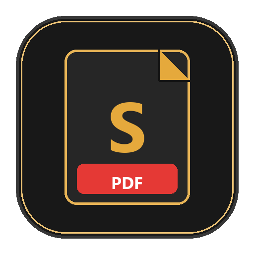

<div align="center">



# Spdf — Professional Desktop PDF Suite

**A modern, lightweight, high-performance desktop PDF reader, editor, and document organizer.**  
*Built natively in Python using PySide6 (Qt) and PyMuPDF.*

[](https://www.python.org/)
[](https://pypi.org/project/PySide6/)
[-E5A93C?style=for-the-badge)](https://pymupdf.readthedocs.io/)
[](LICENSE)
[](https://github.com/)

</div>

---

## ✨ Features Overview

### 📖 Reading & Navigation
- **High-DPI Vector Canvas**: Fast, smooth rendering with crisp page shadows and background workspaces.
- **Interactive Thumbnails**: Drag-and-drop page reordering with live asynchronous background rendering.
- **Bookmarks / Outline**: Hierarchical Table of Contents tree with instant jump navigation.
- **Live Search**: Full-text keyword search with match counters, highlighted preview cards, and jump-to-result.
- **Night Reading Mode**: One-click color inversion (`Ctrl+I`) for comfortable reading in dark environments.
- **Multiple Zoom Presets**: Fit to Page, Fit to Width, Actual Size, and 25%–400% zoom increments.

### ✍️ Comprehensive Annotations
- **Highlighting, Underline & Strikethrough**: Vector text annotations with customizable colors.
- **Freehand Drawing (Ink)**: Smooth Bezier-smoothed pen tool for drawing and handwriting.
- **Text Overlay**: Place draggable, editable text blocks directly anywhere on any page.
- **Sticky Notes**: Click to drop collapsible sticky note comments across document pages.
- **Interactive Canvas Overlay**: Annotations stay interactive (movable, selectable, deletable) until saved or baked.
- **Undo / Redo**: Multi-step history support (`Ctrl+Z` / `Ctrl+Y`) for canvas annotations.

### 📑 Document Organization
- **Merge PDFs**: Combine multiple PDF files in any chosen sequence into a unified document.
- **Split PDF**: Split by custom page ranges (e.g., `1-3, 5, 8-10`) or burst into individual single-page files.
- **Extract Pages**: Extract selected pages into a brand-new standalone PDF.
- **Page Rotation**: Rotate pages individually or globally by 90° clockwise or counter-clockwise.
- **Insert & Delete**: Add blank pages or delete unwanted pages with real-time UI updates.

### 🔒 Security & Digital Signatures
- **Digital Signatures**: Built-in drawing pad modal with mouse/pen input, clear/save, and direct canvas stamp placement.
- **AES-256 Encryption**: Secure sensitive documents with user/owner passwords and permission flags.
- **Permanent Redaction**: Black out sensitive textual or visual information permanently prior to export.

### 🖨️ Printing & Conversion
- **Native Print Support**: Full print dialog (`Ctrl+P`) with page range selection, copies, and orientation control.
- **Export to Images**: Convert PDF pages to high-resolution PNG, JPG, or TIFF (72, 150, 300 DPI).
- **Text Extraction**: One-click extraction of complete document text to `.txt` files.
- **Recent Files Manager**: Quick access to recently opened documents across sessions.

---

## 🚀 Quick Start

### 1. Prerequisites
- Python 3.9 or higher (tested up to Python 3.14)
- `pip` or `uv` package manager

### 2. Installation

Clone this repository and install the dependencies:

```bash
git clone https://github.com/test-bit-sys/Spdf.git
cd Spdf

# Create and activate a virtual environment (optional but recommended)
python -m venv .venv
# On Windows:
.venv\Scripts\activate
# On Linux/macOS:
source .venv/bin/activate

# Install requirements
pip install -r requirements.txt
```

### 3. Launching Spdf

Run the application:
```bash
python main.py
```

Or open a specific PDF file directly:
```bash
python main.py path/to/document.pdf
```

---

## ⌨️ Keyboard Shortcuts

| Shortcut | Action |
|:---|:---|
| `Ctrl + N` | New Blank Document |
| `Ctrl + O` | Open PDF File |
| `Ctrl + S` | Save Document |
| `Ctrl + Shift + S` | Save As... |
| `Ctrl + P` | Print Document |
| `Ctrl + W` | Close Active Tab |
| `Ctrl + Q` | Quit Application |
| `Ctrl + Z` | Undo Annotation |
| `Ctrl + Y` / `Ctrl + Shift + Z` | Redo Annotation |
| `Delete` / `Backspace` | Delete Selected Annotation |
| `Ctrl + +` / `Ctrl + =` | Zoom In |
| `Ctrl + -` | Zoom Out |
| `Ctrl + 0` | Fit Page Width |
| `Ctrl + 1` | Fit Entire Page |
| `Ctrl + I` | Toggle Night Reading Mode |
| `Ctrl + F` | Focus Search Panel |
| `F4` | Toggle Left Navigation Sidebar |
| `Shift + F4` | Toggle Right Tools Panel |
| `H` | Hand / Pan Tool |
| `V` | Selection Tool |

---

## 📦 Building Standalone Executable (Windows)

You can build a standalone, single-file Windows executable (`Spdf.exe`) using PyInstaller:

```bash
# Build executable
python build_exe.py
```

The resulting executable will be generated in `dist/Spdf.exe`.

### Creating a Windows Installer
Run the built-in installer generator:
```bash
python create_installer.py
```
This produces a portable package and Windows setup script with desktop and start menu shortcuts.

---

## 🏛️ Architecture & Project Structure

```
Spdf/
├── assets/                  # Brand assets, high-res logo, app icons
│   ├── app_icon.ico
│   └── logo.png
├── spdf/
│   ├── config.py            # Themes, palettes, zoom presets, ToolMode enums
│   ├── icons.py             # Vector SVG icon renderer factory (50+ icons)
│   ├── style.py             # Modern obsidian dark theme stylesheet (QSS)
│   ├── models/
│   │   ├── document.py      # Core PDF document model (MuPDF bindings)
│   │   ├── render_worker.py # Background asynchronous page & thumbnail renderer
│   │   └── recent_files.py  # Session persistence for recent documents
│   └── ui/
│       ├── main_window.py   # Top-level window, splitters, action wiring
│       ├── ribbon_bar.py    # Quick action toolbar with navigation & tools
│       ├── menu_bar.py      # System menu bar (File, Edit, View, Tools, Help)
│       ├── status_bar.py    # Status bar with dimensions, zoom, page counter
│       ├── tab_manager.py   # Multi-tab manager & welcome screen
│       ├── pdf_view.py      # QGraphicsView canvas with interactive overlays
│       ├── annotation_items.py # Interactive vector annotation items (Ink, Text, Sticky)
│       ├── left_sidebar/    # Thumbnails, Bookmarks tree, Search panel
│       ├── right_tools/     # Organize, Edit, Comment, Protect, Export panels
│       └── dialogs/         # Digital signature pad, Encryption modal, Properties
├── tests/
│   └── test_spdf.py         # Automated headless test suite
├── main.py                  # Application entry point
├── build_exe.py             # PyInstaller build automation
├── create_installer.py      # Installer packaging script
├── pyproject.toml           # PEP 621 packaging metadata
├── requirements.txt         # Dependency specifications
└── LICENSE                  # MIT License
```

---

## 🤝 Contributing

Contributions, bug reports, and feature requests are welcome!
1. Fork the Project.
2. Create your Feature Branch (`git checkout -b feature/AmazingFeature`).
3. Commit your Changes (`git commit -m 'Add some AmazingFeature'`).
4. Push to the Branch (`git push origin feature/AmazingFeature`).
5. Open a Pull Request.

---

## 📄 License

Distributed under the **MIT License**. See [`LICENSE`](LICENSE) for more information.
